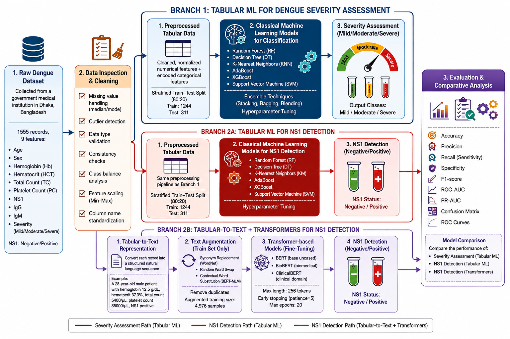
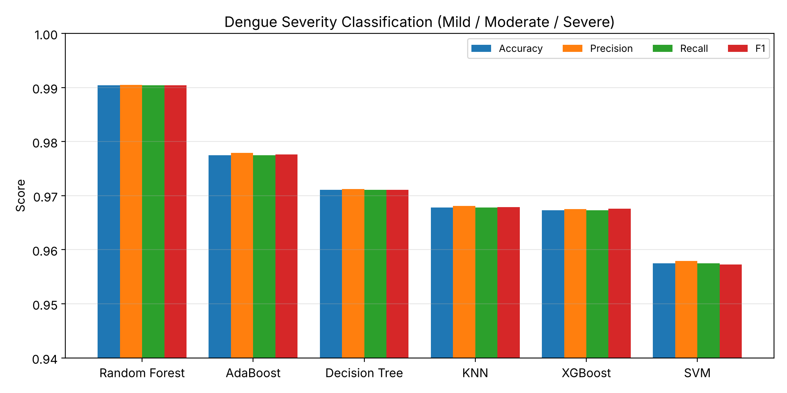
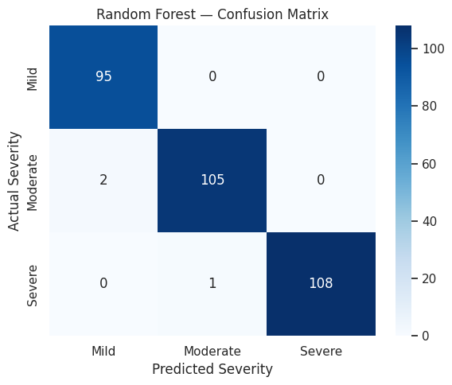
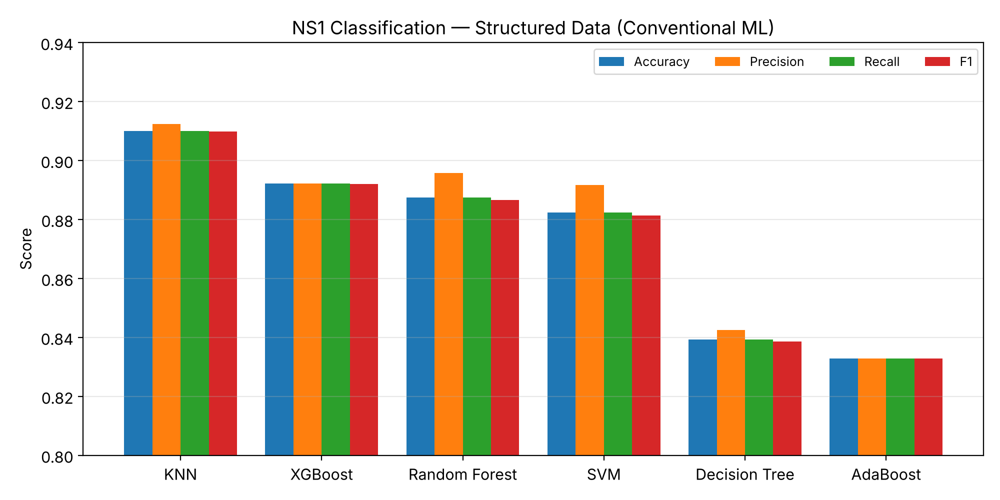
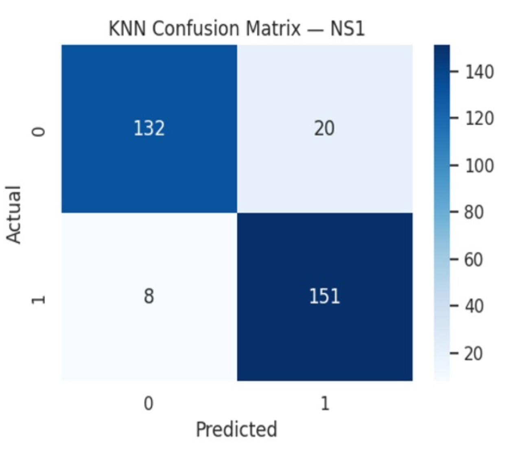
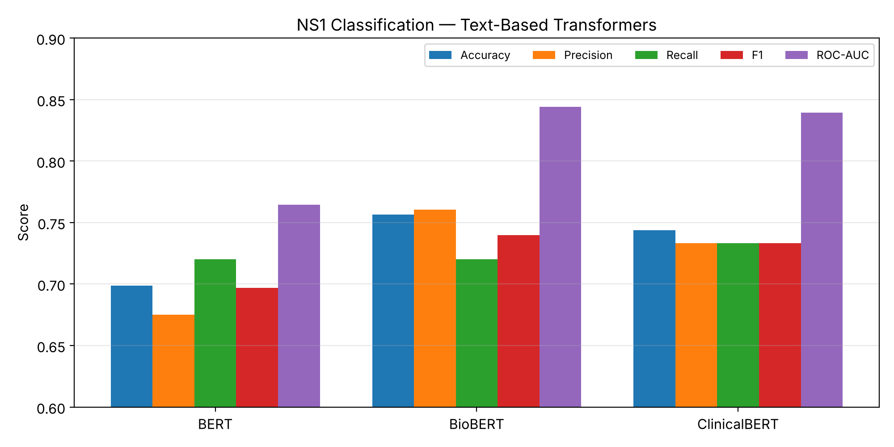
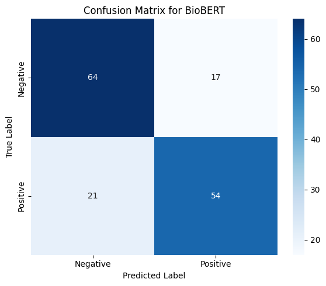

# Dengue Severity Assessment Using Machine Learning and Comparative ML vs Transformer Approaches for NS1 Classification in Bangladesh

<p align="center">
  
  
  
  
  
</p>

> Official repository for the paper **"Dengue Severity Assessment Using Machine Learning and Comparative ML vs Transformer Approaches for NS1 Classification in Bangladesh"** (ICCIT 2026).

---

## 📌 Overview

Dengue remains a major public health challenge in Bangladesh, and NS1 rapid tests or ELISA assays are not always available at the primary care level, while basic complete blood count (CBC) panels are cheap and routine. This work studies two complementary questions:

1. **How well can conventional ML classify dengue severity and NS1 status from structured clinical and laboratory data?**
2. **Can the same patient records, re-expressed as short natural-language descriptions, be classified by domain-adapted transformer models (BERT, BioBERT, ClinicalBERT)?**

The second pathway is relevant for real-world EHR and telemedicine systems in low-resource settings, where free-text notes are often more common than clean tabular fields.

## 🏆 Key Results

| Task | Best Model | Accuracy | Other highlights |
|---|---|---|---|
| Dengue severity (Mild / Moderate / Severe), tabular | **Random Forest** | **99.04%** | Weighted F1 99.04% |
| NS1 classification, tabular | **KNN** | **91.00%** | F1 90.98% |
| NS1 classification, text-based | **BioBERT** | **75.64%** | ROC-AUC 84.41% |
| Best-calibrated transformer | **ClinicalBERT** | 74.36% | Lowest Brier score (0.195) |

## 🧭 Framework

<p align="center">
  
</p>
<p align="center"><em>Fig. 1. Overall framework of the proposed comparative dengue classification methodology.</em></p>

The study has three branches:

- **Branch 1, Tabular ML for severity:** multiclass severity classification with six conventional ML models.
- **Branch 2A, Tabular ML for NS1:** binary NS1 classification with the same six models and preprocessing pipeline.
- **Branch 2B, Tabular-to-text + transformers for NS1:** each record is converted into a sentence-like description and used to fine-tune BERT, BioBERT and ClinicalBERT.

## 🗂️ Dataset

Data were collected from a government medical institution in Dhaka, Bangladesh.

| Attribute | Description |
|---|---|
| Age, Sex | Demographics |
| Hb | Hemoglobin |
| HCT | Hematocrit |
| TC | Total leukocyte count |
| PC | Platelet count |
| NS1, IgG, IgM | Diagnostic test results |
| Severity | Target for severity task (Mild / Moderate / Severe) |

**Splits**

| Experiment | Train | Validation | Test |
|---|---|---|---|
| Conventional ML (80/20 stratified, 1,555 records) | 1,244 | (CV on train) | 311 |
| Transformers (after train-only augmentation) | 4,976 | 155 | 156 |

> ⚠️ The dataset is not included in this repository. Please contact the authors for access requests.

## ⚙️ Methodology

### Leakage-safe tabular preprocessing
- Train/test split is performed **before** any preprocessing.
- Numerical features: median imputation fitted on training data only.
- Categorical features: most-frequent imputation, then one-hot encoding.
- **SMOTE** is applied inside the training pipeline only (never to the test set).
- Feature scaling (StandardScaler) for KNN and SVM only.
- The observed `Severity` field is used directly as the target, avoiding labels derived from threshold rules on the predictors (target-construction leakage).

### Conventional ML models

| Model | Key hyperparameters |
|---|---|
| Random Forest | 100 estimators, max depth 10, balanced class weights |
| Decision Tree | max depth 12, min split 10, min leaf 5, balanced class weights |
| KNN | k = 7, distance weighting |
| AdaBoost | 200 estimators, depth-2 trees (min leaf 10), learning rate 0.1 |
| XGBoost | 350 estimators, max depth 15, learning rate 0.1, multi-class softmax |
| SVM | RBF kernel, C = 100, gamma = `scale`, balanced class weights, one-vs-rest |

### Tabular-to-text and augmentation
Each record is converted into a natural-language sentence stored in the `Converted_Text` field (the target label is excluded from the text). For example:

```text
A 28-year-old male patient with hemoglobin 12.5 g/dL, hematocrit 37.3%,
total count 5400/µL, platelet count 85000/µL ...
```

Training-only augmentation with [nlpaug](https://github.com/makcedward/nlpaug):
1. `SynonymAug` (WordNet synonym replacement)
2. `RandomWordAug` (random word swap)
3. `ContextualWordEmbsAug` (BERT masked-LM substitution)

Originals and augmented variants are concatenated and exact duplicate (text, label) pairs are removed, giving a training pool of up to ~4× the original size. Validation and test sets remain untouched.

### Transformer fine-tuning

| Setting | Value |
|---|---|
| Models | `bert-base-uncased`, BioBERT, ClinicalBERT |
| Max sequence length | 256 tokens |
| Labels | Neg → 0, Pos → 1 |
| Dropout (hidden & attention) | 0.1 |
| Early stopping | on validation F1, patience 5, max 20 epochs |

## 📊 Results

### 1. Dengue severity classification (tabular ML)

| Model | Accuracy | Precision | Recall | F1 |
|---|---|---|---|---|
| **Random Forest** | **0.9904** | **0.9905** | **0.9904** | **0.9904** |
| AdaBoost | 0.9775 | 0.9779 | 0.9775 | 0.9776 |
| Decision Tree | 0.9711 | 0.9712 | 0.9711 | 0.9711 |
| KNN | 0.9678 | 0.9681 | 0.9678 | 0.9679 |
| XGBoost | 0.9673 | 0.9675 | 0.9673 | 0.9676 |
| SVM | 0.9575 | 0.9579 | 0.9575 | 0.9573 |

Random Forest class-level F1: Mild 98.96%, Moderate 98.59%, Severe 99.54%.

<p align="center">
  
</p>

<p align="center">
  
</p>
<p align="center"><em>Fig. 2. Confusion matrix of Random Forest for multiclass dengue severity classification.</em></p>

### 2. NS1 classification using structured data (tabular ML)

| Model | Accuracy | Precision | Recall | F1 |
|---|---|---|---|---|
| **KNN** | **0.9100** | **0.9123** | **0.9100** | **0.9098** |
| XGBoost | 0.8922 | 0.8922 | 0.8922 | 0.8921 |
| Random Forest | 0.8875 | 0.8958 | 0.8875 | 0.8866 |
| SVM | 0.8824 | 0.8917 | 0.8824 | 0.8814 |
| Decision Tree | 0.8392 | 0.8425 | 0.8392 | 0.8386 |
| AdaBoost | 0.8328 | 0.8328 | 0.8328 | 0.8328 |

<p align="center">
  
</p>

<p align="center">
  
</p>
<p align="center"><em>Fig. 3. Confusion matrix of KNN for binary NS1 classification using structured clinical data.</em></p>

### 3. NS1 classification using text (transformers)

| Model | Accuracy | Precision | Recall | F1 | ROC-AUC |
|---|---|---|---|---|---|
| BERT | 0.6987 | 0.6750 | 0.7200 | 0.6968 | 0.7644 |
| **BioBERT** | **0.7564** | **0.7606** | 0.7200 | **0.7397** | **0.8441** |
| ClinicalBERT | 0.7436 | 0.7333 | **0.7333** | 0.7333 | 0.8393 |

ClinicalBERT has the lowest Brier score (0.195). All three models exceed the majority-class baseline (52% on the test set).

<p align="center">
  
</p>

<p align="center">
  
</p>
<p align="center"><em>Fig. 4. Confusion matrix of BioBERT, the best-performing transformer model, for NS1 classification.</em></p>

**Early stopping behaviour**

| Model | Stopped at | Best epoch |
|---|---|---|
| BERT | 9 / 20 | 4 |
| BioBERT | 16 / 20 | 11 |
| ClinicalBERT | 11 / 20 | 6 |

## 💡 Key Findings

- **Structured data is highly predictive.** Ensemble tree methods capture nonlinear relationships among demographic, hematological and diagnostic variables, with Random Forest near-perfect on severity.
- **Local similarity matters for NS1.** KNN performs best on structured NS1 classification.
- **Domain pretraining helps.** BioBERT and ClinicalBERT clearly outperform general BERT on the text pathway (~0.84 vs 0.76 ROC-AUC).
- **The tabular vs text gap is expected.** Text models must recover numeric values from sub-word tokenisation of decimal strings, a known weakness of BERT-family tokenizers.
- **Error direction.** All transformers produce more false negatives than false positives; a recall-oriented decision threshold tuned on validation data is a low-cost improvement before any clinical use.

> The tabular and text experiments use different feature representations, so their absolute numbers are complementary rather than directly comparable.


## 🔭 Future Work

- Evaluation on authentic, clinician-authored triage notes
- Multimodal fusion of the tabular and text pathways
- A unified, like-for-like feature comparison across all models and both targets, with bootstrap confidence intervals
- External validation on other Bangladeshi dengue cohorts and seasons


## 🙏 Acknowledgements

We thank the government medical institution in Dhaka, Bangladesh, for providing the clinical data, and the authors of [BioBERT](https://github.com/dmis-lab/biobert), [ClinicalBERT](https://github.com/EmilyAlsentzer/clinicalBERT), and [nlpaug](https://github.com/makcedward/nlpaug).

## 📬 Contact

For questions or dataset access requests, please open an issue or contact `<your-email@example.com>`.
